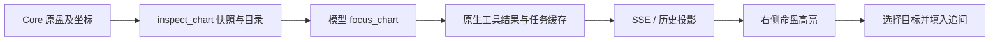

# Agent 功能复核与命盘联动

本轮以 `taibu-agent` 的 `d7cf0068` 为基线，接续“复核审查文档未实现项”完成的四个提交。代码位于独立目录 `taibu-agent-work`；实现与验收期间主目录的 `master` 保留原状态。使用既有 Core 规范 JSON、Pi Durable 工具任务、任务缓存、SSE 与共享命盘组件。

## 功能与交互复核

Pi 对照为本地参考快照 `b2b5c42f`，Pi Desktop 为 `72b5e826`（v0.17.0），应用固定 Durable / AI / Chord / MCP 1.0.4。此次对照覆盖占术 Agent 的功能与交互；不声称核对了参考仓库所有后续提交。Tianfu 的[公开说明](https://tianfuagent.com/about)提供命盘工具及可视化推演的方向，具体交互以用户要求的柱位、关系、宫位和星曜联动为准。

| 领域 | 核查结果与主要实现 |
| --- | --- |
| 域指引、方法命令 | 上轮已接入原生 prompt 分区、共享约定、11 组指引；`method-section.server.ts`、`ComposerCommands.tsx` |
| 执行中调整、待发送队列 | 已有编辑、撤回、排序、优先处理、稳定提交收据及安全边界投递；`AgentQueue.tsx`、`runtime.server.ts` |
| 恢复与上下文 | 已有原生重放、SSE epoch/resync、有界队列、压缩与用量；`durable-projection.server.ts`、`sse.ts`、`AgentContextUsage.tsx` |
| 资料、资源与阅读 | 已有私有资料、分段读取、资源标签恢复/重排、阅读定位、分叉和导出；`AgentWorkspacePanel.tsx`、`attachments.server.ts` |
| 模板、记忆、并行、早报 | 上轮已补齐；工具权限与计费仍由既有服务控制 |
| 模型定位命盘 | 缺少工具动作与盘面状态链路，本轮补齐 |
| 八字关系端点 | 原规范 JSON 只有关系文本，本轮增加实际柱位坐标 |
| 紫微星曜、带引用追问 | 原来只有宫位选择，本轮补齐星曜目标与输入框联动 |
| 全体系盘面 | Agent 原来仅支持八种盘面，太乙、占星、黄历缺少视图；本轮全部十一种支持实体定位 |
| 完整原盘与历史焦点 | 精简工具结果会遗漏时辰、宫头等字段；本轮保留原始计算的完整快照，各盘分别恢复最近模型焦点 |
| 原计算卡片入口 | 从原始卡片固定到工作区时也复用该引用最近的完整查看快照，避免仍显示精简旧结果 |
| 重复查看卡片 | 原计算与后续查看共用一张聊天命盘卡；独立读取已存资料时保留最新查看卡，所有原生工具步骤仍可展开 |
| 查看快照排序 | 按原生 Pi 数值任务序号读取最近快照；成果表没有 `created_at` 字段，不能按该字段排序 |
| 重新查看后的旧焦点 | 同一引用重新查看成功后，先清除该盘旧模型焦点，等待新定位；实际快照变化时清除旧手动选择，未变化时保留手动探索 |
| 不完整盘面 | 嵌套字段缺失、奇门坐标缺失或重复时保留原文本，不生成不可用目标 |
| 已存奇门局式 | 读取历史资料原来未传入已存阴阳遁和局数；本轮复用统一输入构建，保留原局式 |
| 工作区调整宽度 | 移除旧 CSS 的 520px/40% 上限，默认 660px 可容纳完整紫微盘，最多 780px，并给聊天保留至少 360px；键盘与拖动从实际宽度开始调整 |
| 工作区成果数 | 本轮改为按有效命盘去重计数，重复查看及不完整结果不增加命盘数 |

前五项的复核没有确认新的待修复缺陷，属于限定范围的代码结论；验证结果另记于下文。

## 工具与界面

- `inspect_chart({ reference, palace? })`：读取原盘快照并返回定位目录。在本会话产生的十一种命盘用 `artifact:成果ID`；已存资料引用复用八个已有 provider：`bazi_chart`、`ziwei_chart`、`qimen_chart`、`liuyao_divination`、`meihua_divination`、`daliuren_divination`、`xiaoliuren_divination`、`tarot_reading`，格式均为 `类型:资料ID`。紫微默认返回宫位目录，指定实际宫名后返回该宫的星曜目录。
- `focus_chart({ reference, targetIds, caption, includeRelated? })`：定位已查看的盘面，可同时高亮多个实际目标；空数组清除高亮，`includeRelated` 控制紫微三方四正、大六壬对应地支与占星本命相位关联。每次调用及缓存重放均核验当前权限、所有者和会话范围。
- 桌面收到新的命盘工具事件会展开右侧工作区；刷新恢复盘面和焦点。主动关闭后，本任务不再自动展开。手机由用户打开抽屉。
- 用户手动查看会暂停跟随，点击“跟随模型”恢复。模型定位仅滚动工作区，不调用 DOM focus。当前分析主题保持可见。
- 同一命盘重新查看成功后，历史高亮与主题不会套到新快照；新定位到达后再显示。其他命盘的焦点保留。手动选择只对相同盘面内容有效。
- “追问当前位置”保留现有草稿、附带真实命盘引用并聚焦输入框；手机同时收起抽屉。填入草稿不会自动发送或创建任务。

| 体系 | 可定位的实际实体及关联 |
| --- | --- |
| 八字 | 天干、地支、生克、合、冲克、刑、害、半合、三会；关系端点来自 Core 实际柱位，同字不混淆 |
| 紫微 | 十二宫位、各组星曜及四化；宫位/分组/序号区分同名星曜，复用三方四正布局 |
| 奇门 | 九宫、八神、九星、八门、天地盘干；中宫仅显示实际提供的实体 |
| 六爻 | 本卦、变卦、逐爻、伏神，以及已返回的互卦/错卦/综卦与逐爻 |
| 梅花 | 本互变卦、逐爻、体用、阶段推演，以及已返回的错综卦 |
| 大六壬 | 天地盘十二位、天将、四课、三传；可显示对应盘位 |
| 小六壬 | 月/日/时推演步骤与最终落宫 |
| 塔罗 | 各个牌位、原牌序与正逆位，查看时不重新抽牌 |
| 太乙 | 现代九星观测层；传统十六方位及中宫、星将、主客算与将等实际字段 |
| 西方占星 | 本命主星、锚点、宫头、附加点、流运触发、关键相位与完整相位矩阵；原始黄经投影显示本命关联端点 |
| 黄历 | 日期、宜忌、神煞、方位、值日与实际时辰段；原盘包含早/晚子时时均保留 |

原生 ToolTask 的结果是动作真相，客户端从已经投影的工具记录派生视图。计算工具在既有缓存 JSON 中保留 `chartSnapshot`（完整规范 JSON 与文本），与默认工具结果来自同一次 Core 计算；查看时不再次计算或抽牌。占星精确盘保留完整格式，近似盘沿用 Core 的 `more` 格式限制。历史切换使用各引用最近一次 `focus_chart`，而非最后一张盘的焦点。

查看快照的 `inspectionOrder` 取自原生 ToolTask 的数值 ID，随既有缓存 JSON 保存，重放保持相同序号。单条旧查看记录可继续定位；若同一引用有多条缺少序号的旧记录，要求重新查看后再定位，避免猜测新旧。

没有新增浏览器到模型的命盘状态写接口、数据库表或迁移，也没有改变计费流程。已存出生/奇门/六爻资料通过现有构建流程重建一次查看快照；梅花、小六壬、大六壬和塔罗复用已存结果适配器。后续定位使用查看快照，避免资料编辑后把旧目录应用到新盘。太乙、占星、黄历复用当前会话成果，其专用历史资料 provider 不存在，不虚构引用类型。

## 边界与验证

旧命盘若只保留关系文本，仍可显示原文本和真实天干/地支；不按自然语言猜关系端点。占星旧结果缺少数值黄经时仍显示原始卡片，不反推圆盘坐标。没有原始工具数据的旧成果沿用已存命盘链接；缺少问题/用神等必要分析数据的旧六爻记录明确提示无法恢复交互盘面，不伪造计算输入。所有目标仅来自实际返回字段，未返回的扩展项不显示。

专项检查已覆盖十一种默认/完整 JSON 与原生序列化历史、重复干支柱位、缺失坐标、无效目标、所有者与会话限制、停用功能后的缓存重放、八种已存资料读取、快照与缓存一致性，以及丢失外层 checkpoint 后从原生记录恢复动作。浏览器组件检查覆盖所有目标的盘面映射、手动选择、模型跟随、关系端点、星曜键盘选择与三方四正、传统太乙中宫、占星完整矩阵自动展开。

固定本地栈 `taibu-agent-1006b`（`http://127.0.0.1:3196`）的扩展验收使用确定性离线模型，实际运行 Web、worker、数据库、工具缓存及 SSE，一次任务依次计算、查看、定位十一种原盘；检查各盘历史焦点、完整快照、刷新、桌面/手机追问和整任务一次计费。保留原账号及持久卷。离线模型不作为真实解读质量证明。上轮真实域评测记录见 `agent-domain-competence-implementation.md`。

| 检查 | 结果 |
| --- | --- |
| `pnpm verify -- --chrome` | 13 组通过：1,570 项应用/Core/路由/协议测试，20 项包/技能检查，59 项 PostgreSQL，23 项真实 Auth/PostgREST，1 项 Redis，142 项组件浏览器检查；包括 lint、严格类型、架构和生产构建 |
| 补充专项 | 33 项命盘目标、快照排序、资料、边界、卡片去重及重新查看后的焦点回归通过 |
| 最终组件浏览器检查 | 142 项通过，276 次夹具请求，无外部请求或浏览器运行异常；同一已存引用重新查看后清除旧模型焦点，手动选择按盘面内容保留或清除 |
| 固定栈命盘专项 | 十一种真实 Core 原盘、35 个原生工具步骤、各盘焦点、重复查看去重、完整快照、刷新、桌面宽度及 320px 追问、一次计费均通过 |
| 固定栈完整浏览器回归 | 7 个主场景任务通过；包括真实 worker 崩溃与租约接管、刷新重连、成果幂等、停止退款、补充信息、编辑续跑、私有资料与分叉、普通/虚拟阅读、模板/记忆、普通对话和全体系命盘联动；无外部请求、服务端 5xx 或浏览器运行异常 |
| 最终本地构建 | `pnpm local:update` 通过，Web 与 worker 已更新到最终代码，既有账号和持久数据卷保留 |

最终复核发现同一引用重新查看后仍可能沿用旧焦点，本轮已修复并补充单测与浏览器回归。查看快照排序、重复卡片、CSS 宽度限制和焦点修复均已纳入最终全量门禁；固定栈完整浏览器回归验证真实服务链路。语音浏览器事件使用测试替身，整栈模型为确定性离线夹具。

各体系实际页面截图位于私有 `.taibu-local/taibu-agent-1006b/agent-chart-*.png`，不提交到仓库。按本次交付指示，先提交 `taibu-agent`，再合入本地 `master`；不包含远端推送。
