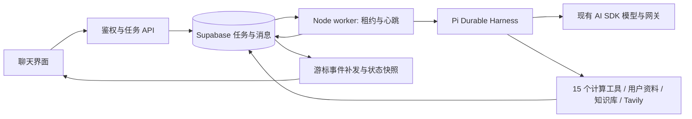

# 太卜 Agent

`/chat` 在 Agent 开关开启、worker 在线时默认进入 Agent，可在输入框上方切换普通对话。运行中的任务可以补充信息、调整方向、排队续问和停止。关闭页面不会停止任务；再次打开同一对话会恢复服务端状态并重连。

## 运行链路



执行内核固定为 `@earendil-works/pi-durable@1.0.4`，配套 Pi AI／Chord 同版本。使用原生 Harness、GenerationTask、ToolTask、CompactionTask、请求去重和队列；模型桥接继续经过 `pi-stream.server.ts` 的 AI SDK，复用模型配置、网关排序、来源切换、推理和采样配置。开始输出后不会重新切换来源。模型和摘要权限在服务端重新校验，SDK 错误不会打印上游凭据。Durable 目前是实验接口，版本固定，并用官方存储契约测试检查适配器。

没有任务步数、检索次数或总运行时长上限。结束条件是模型完成、`ask_user` 等待补充、用户停止或不可恢复错误。外部请求仍有单次超时。Durable 按已配置的模型窗口选择完整工具回合的压缩边界；未知模型使用 Pi 的 `contextWindow: 0`，跳过容量阈值判断，在可识别的供应商超限错误后尝试一次压缩恢复。摘要通过原有 AI SDK 和网关生成，保留最近消息、成果 ID 和实际来源。完整原始记录保留在 Durable 提交日志中。

## 工具与成果

15 个计算工具直接复用 `taibu-core/mcp` 的定义、输入校验、引擎及规范 JSON／文本输出。工具结果按业务任务、Durable ToolTask ID 和模型调用 ID 暂存；随机种子从这个稳定标识产生。重启重放同一 ToolTask 会复用结果，模型在不同回合重用调用 ID 会生成不同工具任务。只有具备幂等缓存的业务工具声明安全重放。

11 份解读 guide 在构建时嵌入，与 skill 共享唯一映射。模型先看到按当前工具集过滤的简短体系目录，需要时使用 `load_analysis_method` 读取完整指引；工具名或旧 guide ID 均可加载。计算仍由 Core 完成，方法包不增加执行权限。参数准备只归一化确定的表示错误，错误出生时刻和历法会被拒绝。

多个体系资料完整时可调用 `parallel_analysis` 并行分析，子会话只提供该体系的计算及方法工具，禁止再嵌套。父任务汇总、选择成果，整体扣一次积分。子分析重启复用原生收据；用量面板累计父子模型请求、工具及压缩摘要的 token，不显示未经配置的金额。

`ask_user` 在原生 ToolTask 中提交问题 memo 后等待，外层任务进入 `awaiting_input` 并关闭当前 Harness。补充输入进入同一 Durable 队列，回复 memo 落库后恢复该 ToolTask；不创建新业务任务，也不再次扣费。正常进程退出和租约故障关闭 Harness，保留待恢复任务；用户停止则写入原生 abort 并等待工具结束。

个人命盘、历史、个性化档案和知识库使用已有服务。工具注入当前任务所属用户，并在每次执行及缓存重放前直接读取会员和功能开关；配置读取失败拒绝执行，不复用宽松缓存。模型回合和压缩摘要也遵守这一规则。知识库 RPC 绑定当前租约的用户，查询结束后恢复管理员会话的 JWT 上下文。普通会员的联网、Plus/Pro 知识库和 Pro 向量权限保持现有规则。

Tavily 工具按需检索，返回标题、摘要和 URL；来源卡片仅使用实际返回的 HTTP(S) 来源。用户可关闭联网。附件提取复用现有 Dify 流程。网页、用户资料和工具返回都作为资料处理，不能改变工具权限。

Agent 在最终答复前通过 `select_final_artifacts` 选择成果，支持空选择。成功完成时一次事务保存聊天消息并复用或新增标准八字／紫微命盘，**不自动新建命理记录**。无法转换为原生命盘的计算口径及规范工具结果保留在聊天过程和 Durable 日志中。命盘身份仍包括时区与 DST 策略。已有资料的修改、删除通过原有界面进行，历史分析记录和链接保留。

## 持久化与结算

迁移 `20261005_100000_agent_runtime.sql` 提供六张业务运行表；`20261005_120000_agent_chart_identity.sql` 在排盘时间字段迁移后更新命盘身份与去重；`20261006_100000_agent_pi_durable.sql` 增加 `agent_durable_commits` 和 worker 引擎标识。安全对象显式设置 `search_path` 和执行权限。原生日志只由受租约保护的管理员 RPC 读取／提交，普通用户不能直接读取或写入。公开消息修改仍受活动任务保护。

任务状态：`queued → running → awaiting_input / completed / cancelled / failed`，停止过程使用 `cancelling`。租约每秒续期，失效窗口为 60 秒；新的 worker 接管时递增执行版本，旧版本不能写入。每个业务任务对应独立的 Durable Storage，只允许当前租约进程推进。RPC 原子保存原生写批次及业务检查点，连续序号和相同批次去重保证丢失响应可重试；指令在原生 submission 进入 placed 状态时才被确认消费。结果不明时暂停当前执行并由新持有者重读日志。

存储适配复用 Pi MemoryStorage 的提交校验、索引、文档历史和分叉语义，先提交 PostgreSQL 日志，再应用已确认批次。重启分页重放日志后由 Harness 接续原生任务。这与官方 JSONL 后端一样会把当前任务的索引和历史保存在进程内存中，日志随任务长度增长；上下文压缩不会删除原始记录。大规模部署应监测单任务内存及日志增长，后续可替换为通过相同契约的 SQL 查询后端。

V2 检查点由 Durable worker 执行；混合版本部署中 Core worker 只能领取 V1。旧检查点首次接管时补齐已提交工具结果并一次导入历史，后续恢复统一走原生机制。已转换的活动任务需要 Durable worker 完成，回滚应用前应先停用新任务入口并完成这些任务，保留新增表与列。

命盘保存、业务任务状态、最终消息及完成事件仍由原有结算事务一起提交，保存成功而响应未到不会重复生成成果。`20261007_100000_agent_chat_results.sql` 将选定命盘保存与 MingRecord 分开；RPC 保留旧 `p_record` 参数以兼容旧 worker，但不再消费该参数。SDK 必须提供有效结束事件；异常 EOF、超时或 abort 会进入失败／停止路径，保留已显示正文。worker 退出及租约故障仍保留原生待恢复任务。

创建使用用户和 `clientRequestId` 去重，相同 ID 携带不同内容返回 409。活动对话只允许一个任务。指令接受和任务结算使用同一行锁：在最终回合落库前收到的指令会继续执行，再保存最终成果。

`20261006_110000_agent_lifecycle_fixes.sql` 在每次编辑／重新生成前更新当前版本槽位的正文、Agent 信息及完整后续消息，支持切回旧分支后再编辑。复用现有 JSON 版本和积分账本，不新增表或字段，也不回填已丢失的旧分支。该迁移同时阻止删除存在活动任务的对话（直接 DELETE 和图删除 RPC 均受保护）；先停止任务，等待结算完成，再删除。它追加于 Pi Durable 迁移后，保留原有结算与退款函数。

托管模型在创建事务中扣 1 次积分，自定义模型不扣。补充、调整、排队续问和恢复共用任务。失败／停止时没有可见正文且没有保存成果则退款一次；有正文或成果则保留扣费。新请求在上一任务结束后创建新任务。

BYOK 沿用浏览器的自定义模型界面，启动时将密钥提交给服务端，使用 AES-256-GCM 保存任务副本，AAD 绑定用户和任务。密钥不写入消息、事件、检查点、日志或响应。等待补充时保留副本，完成、失败、停止时删除。自定义服务必须是公开 HTTPS 地址；socket DNS 解析拒绝私网、保留地址和混合解析结果，并拒绝重定向。平台网关使用管理员管理的配置。

## 启动与配置

Node 需要 `>=22.19`；Docker 使用现有 Node 24 镜像。

```bash
pnpm install
pnpm dev                 # Web
pnpm agent:worker        # 另一终端：构建 core/worker 并启动后台执行
```

生产构建 `pnpm build` 会生成 `.agent/worker.mjs`。在与 Web 使用相同运行环境的常驻进程中执行：

```bash
node .agent/worker.mjs
node .agent/worker.mjs --check   # 仅验证构建加载，不访问数据库
node .agent/worker.mjs --health  # 检查最近 30 秒内的 worker 心跳
```

构建会将 Core 的公开包与运行依赖一并放入 `.agent/node_modules`，保持计算引擎的模块边界。worker 的外部 Next 服务端入口由 Docker runner 携带，并在镜像构建时执行 `--check`。新增依赖的许可证随 `.agent/licenses` 打包，Pi 原始 MIT 许可证保存在 `licenses/pi.LICENSE`。模型请求和摘要的单次超时为 5 分钟，Agent 数据库 RPC 为 30 秒，BYOK 连接与检索另外使用各自的请求超时；它们不限制任务总时长。租约续期从启动开始，覆盖长日志重放阶段。

Web 和所有 worker 需要相同的 Supabase URL、anon key、系统管理员账号、模型密钥和任务加密密钥。新增变量见 `.env.example`：

| 变量 | 用途 |
| --- | --- |
| `TAVILY_API_KEY` | Tavily 搜索；为空时不提供联网工具 |
| `AGENT_CREDENTIAL_ENCRYPTION_KEY` | 32 字节标准 Base64；BYOK 后台任务必需 |
| `AGENT_WORKER_CONCURRENCY` | 每个 worker 并发，默认 2；不限制任务长度 |
| `AGENT_MCP_SERVERS` | 可选 JSON 服务配置，公开 HTTPS 地址、唯一名称、工具白名单和可选 `tokenEnv`；最多四个服务 |

MCP 工具只在用户开启联网且会员允许时提供。worker 需要管理员列出的 token 环境变量；Docker 用私有 Compose override 显式传入这些变量。服务返回内容是资料，服务器指令不加入任务指令。DNS 解析拒绝私网和混合地址，重定向被拒绝；外部副作用不自动重放。

使用 `openssl rand -base64 32` 生成任务密钥，在秘密管理中设置并备份。所有 worker 必须一致；轮换前先结束已有 BYOK 任务。功能开关沿用管理中心的 `feature_disabled:agent`。`GET /api/agent/status` 向登录用户返回功能、worker、联网及加密服务可用状态，未就绪时界面保留普通对话入口。

Docker runner 同时包含 Web 和 worker 构建，可使用同一镜像的两个服务：Web 默认命令为 `node server.js`，worker 命令为 `node .agent/worker.mjs`。`docker-compose.local.yml` 和 `selfhost up` 提供 worker 与健康检查。固定 3196 测试栈支持本次经哈希审定的增量迁移；其他未知基线继续拒绝，禁止重放初始化。

线上迁移按仓库规范通过 Supabase MCP 执行。完整空库自托管基线包含该迁移；已有自托管数据库只应用增量迁移，不重放空库基线。

## API 与事件

| 请求 | 用途 |
| --- | --- |
| `POST /api/agent/runs` | 创建任务；拥有的 `conversationId`、`clientRequestId`、用户消息及模型配置 |
| `GET /api/agent/runs?conversationId=…` | 读取对话的最近任务 |
| `GET /api/agent/runs/:id` | 读取拥有的任务快照 |
| `GET /api/agent/runs/:id/events?after=…` | SSE，补发游标后的事件再发送一致的完整快照 |
| `POST /api/agent/runs/:id/messages` | `reply / steer / follow_up`，指令也使用 `clientRequestId` 去重 |
| `POST /api/agent/runs/:id/cancel` | 请求停止；等待 worker 安全结算 |

公开快照包含任务状态、`cursor` 和版本 1 的聊天消息。消息包含有序正文、推理、工具、问题、来源、成果部分，并生成普通消息可读的 `content`。SSE `history` 事件重放持久化事件，`snapshot` 提供当前完整公开状态；连接中断、刷新或浏览器关闭均不会取消任务。

SSE 继续兼容 v1 游标，并提供 worker `epoch`。执行版本变化、游标超前或缺少事件时发送 `resync` 和完整快照。事件序号为全局序号，不要求单任务连续。服务端待发送数据上限为 8 MiB，慢连接关闭后浏览器重新读取快照；浏览器 30 秒无数据会断开重连。

个性化设置可管理最多 20 个问法模板及默认关闭的长期记忆。输入框“问法模板”按钮将当前问题代入 `{{question}}`；模板和语音都只填入草稿。语音按钮使用浏览器识别服务，可能联网；用户编辑草稿后识别结果不会覆盖已有内容。新迁移 `20261008_180000_agent_competence.sql` 提供记忆表及 owner/来源/租约约束，用户可查看、手动保存和删除，关闭开关不删除记录。Agent 仅摘录明确表达的原话，不能保存模型推断。

早报通过受限原生 Agent 读取黄历和已存命盘，沿用既有 job 的一次预占、成功结算及失败退款。独立评测入口、实现与验证记录见 [域能力补全说明](../agent-domain-competence-implementation.md)。

快照还包含创建请求标识与公开用户消息。浏览器对丢失响应及服务端故障使用相同创建请求重试，在结果不明时保留请求标识并查找已接受的任务。补充／排队指令的自动及手动重试也保留原内容、模式和请求 ID，即使等待态已恢复。等待补充期间 SSE 继续订阅，其他标签页恢复或停止任务会更新当前界面。所有异步回包绑定用户登录周期和对话选择周期；发送成功仅清理提交后未更改的草稿，保护新的输入、引用和附件。旧任务的迟到快照不能替换新任务；恢复状态、同步历史版本期间锁住输入和历史操作。新的计算或追加指令会重新要求确认最终成果。

Pi 原生语义与宿主边界：`submit(requestId)` 是持久化收据去重，宿主必须重用原 ID 和完整内容；`placed` 表示输入已被采用，`done` 才表示已回答。`Harness.close()` 保留可恢复工作，`Conversation.abort()` 持久化停止请求。`ask_user` 在同一 ToolTask 内使用问题／回复 memo。模型流的 `end()` 只关闭事件流，成功由正常 `done` 事件与 stop reason 决定。观察器停止后还须等待已开始的投影回调，再提交最终状态。聊天版本由现有消息 JSON 管理，每个业务任务拥有独立原生日志，不用原生 fork 代替聊天版本。

## 本次变更范围与验证

分支 `codex/agent-chat` 从 `5725dde` 创建，保留原有工作区改动。Agent 新增范围是 `src/lib/agent`、`src/app/api/agent`、Agent 消息组件、迁移及专项测试；集成改动集中在聊天 hooks／界面、AI SDK 适配、知识库持久化注入、功能开关、消息类型、成果入口、worker 构建／部署配置和 schema 文档。已有 core 算法、自托管及其它未提交改动保持独立。

| Agent 变更组 | 文件范围与集成点 |
| --- | --- |
| 执行与安全 | `src/lib/agent/*`：Pi 适配、工具、检查点、租约、凭据、目标地址校验、浏览器重连 |
| 接口 | `src/app/api/agent/*`：状态、创建、读取、事件、指令与停止 |
| 聊天 | `AgentMessage.tsx`、聊天 layout／composer／message／hooks、`src/types/index.ts`：模式切换、有序部分、任务恢复、历史版本 |
| 现有服务 | AI SDK provider 导出复用入口、知识库 search 注入持久化权限、`app-settings.ts` 功能开关、records 页面成果入口 |
| 数据库 | Agent 运行、命盘身份、Durable 和生命周期四份迁移、schema 快照、自托管空库生成器与数据库合同测试 |
| 运行与部署 | `scripts/agent-worker.mjs`、`scripts/build-agent-worker.mjs`、Dockerfile／Compose、selfhost worker 就绪检查、Pi 许可证 |
| 验证与说明 | `src/tests/agent-*.test.ts`、`scripts/tests/agent-*.mjs`、环境变量、架构及部署文档 |

表中已有文件仅记录 Agent 集成部分，不将整份文件的既有修改归入 Agent。开始前保存了 HEAD、工作区／暂存区 diff 与状态快照，位置为本机临时目录 `taibu-agent-baseline-fk9fpljn`。

验收期间对既有紫微改动中的一处未闭合函数调用补齐了右括号，仅作为语法修复；没有重写其算法。Docker 原有 `taibu-local` 服务和数据未修改。每次隔离建库使用新的项目名与端口；对已有验收栈更新应用代码前，核对初始化 SQL 正文、限流增量和 Storage SQL 完全一致，不重放基线或修改数据库版本标识。

```bash
pnpm test
pnpm lint
pnpm typecheck
pnpm build
pnpm test:db
pnpm test:auth
node scripts/tests/agent-selfhost-browser.mjs --project <独立演示项目> --chrome
```

专项检查覆盖超过常见循环阈值、摘要、缺信息暂停后继续、缓存结果恢复、截断参数、接口权限、AES-GCM、DNS/重定向、SSE 重连、扣费／退款、租约接管、晚到指令、保存和事件的原子性及命盘复用。浏览器验收使用独立的自托管数据库和确定性离线模型，真实经过 Next API、AI SDK、Pi、worker 和保存流程；这不代表真实模型的推理质量或 Tavily 外网可用性。真实联网和线上 Supabase MCP 迁移需另行配置验收环境。

### 2026-10-05 Core 基线本地隔离验收结果

| 检查 | 结果 |
| --- | --- |
| `pnpm test` | 1400 / 1400 通过，0 跳过 |
| `pnpm test:db` | 41 / 41 通过，0 跳过 |
| `pnpm test:auth` | 21 / 21 通过，0 跳过 |
| `pnpm lint`、`pnpm typecheck`、`pnpm build` | 全部退出码 0 |
| `node .agent/worker.mjs --check` | worker 构建及运行依赖加载通过；Docker 镜像构建也执行同一检查 |
| 生产浏览器端到端 | 6 个真实任务通过，0 外部请求、0 服务端 5xx、0 页面运行时异常 |

运行单测实际执行了 37 轮模型调用和 35 次八字计算，验证任务不会被常见默认循环阈值截断。浏览器使用项目 `taibu-agent-verified-1005` 与独立数据库，覆盖跨命盘、最终保存与成果入口、重复提交、编辑与重新生成、补充后续跑、刷新恢复、移动端、停止退款及普通对话。通过强制终止 worker 再启动验证 60 秒租约过期后的接管，已提交计算未重复执行，分析未重复保存，积分仅扣一次。

截图保留在该项目私有目录中的 `agent-acceptance.png` 与 `agent-mobile-acceptance.png`。临时开发服务器及三个本次验收项目均已停止，隔离卷保留；Agent 验收镜像保留为 `taibu-web:agent-verified-1005`。原有 `taibu-local` 容器持续运行且健康，`taibu-web:local` 已恢复到其原始镜像，避免影响后续重启。

既有问题：原始镜像 `8cd4056e484f` 的匿名 `/chat` → `/records` 导航也间歇出现 React hydration #418。该告警可由原有版本独立复现；最后一轮 Agent 完整浏览器验收没有出现。后续页面渲染维护应单独跟踪这一问题。

真实 Tavily 联网、真实模型推理质量及线上 Supabase MCP 迁移尚未执行，按本次要求保留为外部环境验收项。当前交付是工作区实现与本地验证，没有提交或部署。

### 2026-10-06 Pi Durable 切换验收

直接依赖已替换为 Pi Durable／Pi AI／Chord 1.0.4，移除 Pi Agent Core。Web 的历史转换与 worker 执行模块分开，任务消息格式仍为 V1，原生检查点为 V2；新增迁移和空库基线保持原子积分／保存事务。

| 检查 | 结果 |
| --- | --- |
| `pnpm test` | 1459 / 1459 通过，0 跳过 |
| 原生执行专项 | 20 / 20 通过：37 轮模型、35 次计算、分次补充、旧任务迁移、恢复与请求超时 |
| 存储适配 | 官方 23 项存储契约，加分页重开和丢失收据检查，共 25 / 25 通过 |
| `pnpm test:db` | 43 / 43 通过：提交／检查点原子性、消费确认、混合 worker 与租约隔离 |
| `pnpm test:auth` | 21 / 21 通过；使用真实 GoTrue／PostgREST |
| `pnpm lint`、`pnpm typecheck` | 退出码 0 |
| Docker 中的 `pnpm build` | 生产 Web／worker 构建通过；主机与 Linux 镜像中的 worker `--check` 均通过 |
| 浏览器复跑 | 6 个任务及普通对话通过，外部请求、5xx、页面运行时异常均为 0 |

浏览器通过真实终止 worker 验证 60 秒租约接管、缓存计算不重做、一次扣费及一次保存。第一轮仍捕获既有 React hydration #418，第二轮完整严格验收为 0 异常；保留这一既有问题的独立追踪。截图位于私有项目 `taibu-durable-1006` 的验收目录。

最终镜像再次通过完整严格浏览器验收，保留为 `taibu-web:agent-durable-1006`（`sha256:68b467e860901f0943b2ac7f780b4eecfca579ccebd00ef34b794058100a7b9e`），已核对包含旧问题迁移、启动阶段续租与 RPC 超时。隔离栈停止，卷与截图保留；原有 `taibu-local` 服务不变，共用 `taibu-web:local` 恢复到原始镜像。

主工作区 `.next` 被另一构建进程持有，使用独立 Docker 构建运行 `pnpm build` 并验证生产运行依赖，不删除或抢占对方构建锁。切换前另存了 `taibu-pi-durable-baseline-cn8qo3gv` 备份，保留原有未提交修改。真实外部验收和线上 MCP 迁移继续按用户要求延后。

### 2026-10-06 独立审查问题修复验收

修复限流返回值、SDK abort／异常 EOF 结算、重复编辑的分支尾部保存、跨对话异步回包、等待输入订阅、命令重试收据、活动对话删除结算保护、草稿竞态与 fresh 权限检查。真实浏览器另复现并修复空对话缓存卡在 loading 的问题。全部在 `codex/agent-chat` 的隔离工作树完成，未提交、部署或执行线上迁移。

| 检查 | 当前结果 |
| --- | --- |
| `pnpm test` | 1471 / 1471，0 跳过 |
| `pnpm test:db` | 46 / 46，含连续编辑／旧分支再编辑，以及四种活动状态下删除保护和一次退款 |
| `pnpm test:auth` | 21 / 21，真实 GoTrue/PostgREST，临时资源已清理 |
| 离线浏览器 hooks 验收 | 95 项；含 A→B→A、等待输入跨标签页恢复／取消、丢失响应重试、草稿与同账号重新登录竞态；0 运行时异常 |
| lint、严格类型、Web／worker 构建、worker `--check` | 均通过 |

本轮浏览器为实际 React hooks 和受控 HTTP／SSE 边界，未复跑此前 Docker 生产浏览器端到端套件；外部模型、Tavily 和线上 Supabase 边界继续保留。增量迁移只在一次性数据库中验证，已有部署须应用 `20261006_110000_agent_lifecycle_fixes.sql` 才具备新的分支／删除保护。

### Agent 工作区界面

参考 [PI-Desktop 的工具展示与聊天布局](https://github.com/vastsa/PI-Desktop/tree/176e1cf7187855b7354cf5709f68a90fa5dab6a0/apps/desktop/src)，任务过程按连续工具／思考分组，显示步骤完成数、失败状态、参数和结果；完成后自动折叠，用户可自主展开。实时阶段投影自 Pi `pi.live`，区分等待模型、思考、工具执行、压缩与整理结果。输入区支持执行中调整任务／排队继续，中文输入法选字不会触发发送。

`ask_user` 等待时自动打开提问弹窗。弹窗按用户／对话／任务／问题 ID 隔离，聚焦回答框并限制键盘焦点；Escape 或「稍后回答」关闭后保留草稿和等待状态，点击「回答问题」重新打开。提交沿用 `reply` 指令、同一任务及原扣费。刷新后从服务端问题恢复弹窗。

模型与上下文位于工具栏右侧、发送按钮左侧。Agent 停用旧 `/api/chat/preview` 提示层估算，使用 Pi 的活动 transcript 和 [`estimateContextTokens`](https://github.com/earendil-works/pi/blob/v1.0.4/packages/ai/src/utils/estimate.ts)：最近有效 usage 为已测基准，后续消息显式标为估算；压缩后旧基准失效。检查器区分已测／混合／估算、缓存读写、输出和压缩次数，SDK 缓存与推理子计数不重复加总。未知模型容量不套用 32k，不显示百分比；已知上限标为应用配置。普通对话继续使用原有提示预算。

八字、紫微、奇门、六爻、梅花、大六壬、小六壬、塔罗、太乙、西方占星和黄历工具成功后，命盘卡片自动出现在对应任务步骤中；任务过程折叠后仍能访问。点击「展开命盘」查看工具返回盘面，「固定到工作区」在桌面宽屏打开右侧工作区，手机使用全屏查看。模型查看新的原盘时，桌面工作区会自动展开；同一任务中主动关闭后保持关闭。展示使用已持久化的实际工具结果，刷新和历史恢复不重新排盘、不保存第二份记录、不扣费；模型定位仅滚动工作区，保留用户的键盘焦点。字段不足或视图异常时保留规范文本。查询、来源和知识库使用对应结果列表，参数与原始结果仍可展开和复制。

模型分析时，盘面显示当前主题与正在查看的位置，包括干支关系、宫位星曜、门星神、卦爻体用、四课三传、推演步骤、牌位、太乙星将、占星相位和黄历时辰。点击盘面中的实体会暂停跟随，点击「跟随模型」恢复；切换历史命盘保留各盘最近的模型焦点。「追问当前位置」保留现有草稿并附带原盘引用，用户发送后才创建任务，手机同时收起抽屉。具体目标与旧记录边界见 [全体系命盘联动说明](../agent-chart-interaction-review.md)。

点击右上角「工作区」查看当前对话的命盘、来源与最近任务过程。工作区支持多资源标签并在当前会话恢复，关闭资源标签不会删除成果。历史记录链接继续可用；任务结束后未完成的工具不再持续转圈。仅显示当前消息分支的成果。

多轮对话采用统一内容列、按内容收缩的用户气泡与统一 Markdown 排版。任务内的补充回答通过任务关联显示在后续任务输出之前；刷新后仍恢复该顺序，旧会话可从任务快照恢复关联。消息的复制、编辑、重新生成、知识库归档及历史版本切换使用一致的操作区。上滚阅读或展开步骤后停止跟随新输出，点击「回到最新」恢复跟随；普通列表与长对话的虚拟列表共用阅读规则。

模型、上下文、输入工具、消息及会话菜单共用按视口翻转和收边的浮层，支持方向键、Escape 与焦点返回。提问、命盘展开、确认、知识库选择和移动端抽屉共用原生模态对话框，键盘焦点留在弹窗内；抽屉内的会话菜单保留在同一顶层，Escape 先关闭菜单。桌面任务工作区支持拖动或方向键调整宽度。设置使用独立的 `/settings/<分类>` 页面，旧 `#settings/...` 链接自动转换；具体地址和草稿保护见 [界面与设置说明](../ui-settings-agent.md)。

输入草稿按账号与对话隔离，在当前标签页的刷新与切换中恢复文字、引用和联网选项。Agent 的私有图片与文本资料保存附件 ID，可在刷新后恢复；普通对话的临时提取文件仍仅驻留内存。退出或切换账号时清理前一账号的草稿。新对话建立后转移原草稿，发送成功只清理该次提交后没有继续编辑的内容。

本地固定测试入口为 `http://127.0.0.1:3196/chat`，项目 `taibu-agent-1006b`，更新使用 `pnpm local:update`。详见 [固定通用测试栈](Self-Hosting.md#固定通用测试栈3196)。

2026-10-07 本轮累计验收：最终全量测试 1494 / 1494、独立 PostgreSQL 契约基线 46 / 46（均无跳过），lint／架构检查、严格类型、生产 Web／worker 构建和 worker 加载检查通过。3196 生产容器浏览器验收完成 6 个 Agent 任务及普通对话，覆盖命盘复用、聊天分析、Pi 上下文与右侧控件、提问／设置／自定义模型弹窗的焦点循环和返回、任务补充回答顺序及旧会话刷新恢复、会话草稿、普通／虚拟列表阅读位置、嵌套菜单、工作区宽度、320px 布局、一次扣费／退款和真实 worker 崩溃恢复；未捕获外部请求、5xx、水合或其他运行时错误。模型为确定性的离线 demo，未验证外部供应商或真实联网。

### 五批体验与能力扩展

阅读区新增流式 Markdown 稳定块缓存、按需 Shiki、表格操作、小地图和统一消息定位；阅读列宽为 560–1200px，字号四档作用于全站 rem。工作区资源支持命盘、来源、工具结果和资料预览标签的切换、关闭、排序、键盘导航及会话级恢复。

输入区支持斜杠命令、全局对话搜索、历史召回和可撤销润色。Plus/Pro 默认每天最多五次润色实际调用，不扣积分。任务运行时修改的模型、联网等配置标为「下次使用」；当前任务及其补充、续问保持原配置，下一个独立任务发送前重新校验权限。

提问工具兼容旧字符串，并支持有稳定 ID 的多问题、单选、多选、自填、跳过和提交前汇总。任务清单最多 50 项且最多一项执行中。未投递续问可编辑、撤回、排序或提前处理；领取后锁定，RPC 与 worker 共用任务行锁。停止后可将取消的续问恢复为草稿。分析方法按版本目录按需加载；压缩保留摘要、范围、位置及失败原因。来源切换和瞬态重试共享每次模型调用三次外部尝试，已有输出不重启；空答复最多恢复一次。

完成回答可分叉成独立对话，复制部分是只读历史，分叉不扣费或复制运行状态。导出 Markdown／可打印 HTML 默认包含当前分支正文、命盘依据和来源，工具详情由用户选择。Agent 图片每条最多四张、原始文件最多 10MB，限平台视觉模型；超过 8000 字符的纯文本粘贴自动转为私有文本资料。文件与消息、版本、队列和分叉通过 ID 关联，最后一个引用解除后才回收；未绑定文件 24 小时后回收。Durable 日志不保存 base64 或签名 URL。

任务完成、失败、等待补充生成幂等站内提醒；网页打开且用户主动授权后可使用桌面提醒。每日早报默认关闭，用户可设置时区和时间，默认当地 08:00；成功每天一份扣一积分。原子预占、租约、三次生成尝试、失败一次退款和独立通知投递复用现有 scheduler，以五分钟轮询恢复停机期间的当天工作。余额不足跳过当日。

增量迁移 `20261007_110000` 至 `20261007_190000` 与对应自托管基线必须先于 Web／worker 更新。应用通过普通 authenticated 系统管理员会话访问后台，新增表、RPC 和私有 Storage 均复用管理员权限边界。自托管更新完成后刷新 PostgREST schema 缓存；Sharp 原生依赖随 standalone 产物携带，镜像构建验证实际图片处理。`AGENT_ATTACHMENTS_ENABLED=false` 可关闭新上传，`DAILY_BRIEFING_ENABLED=false` 可关闭早报生成并退回未结算预占。具体完成与验收记录见 [实施记录](../agent-experience-implementation.md)。

### 2026-10-08 界面与自动命盘验收

设置已迁移到独立页面，命盘自动显示于工作流中并支持展开、固定与手机全屏。工作区复用已持久化的工具结果，按成果 ID 去重；查看和恢复不重新排盘、保存或扣费。

全量测试 1524 / 1524、组件浏览器回归 113 项、lint／架构检查和生产构建通过。固定栈 `taibu-agent-1006b` 的完整生产浏览器验收再次完成 6 个 Agent 任务及普通对话，含取消设置后退／前进／刷新、一次扣费／退款及真实 worker 崩溃接管；外部请求、5xx 和运行时异常均为 0。八种占术视图使用真实 MCP 输出验证，外部模型与真实联网仍未验收。详见 [界面、设置与验收记录](../ui-settings-agent.md#2026-10-08-验收结果)。
